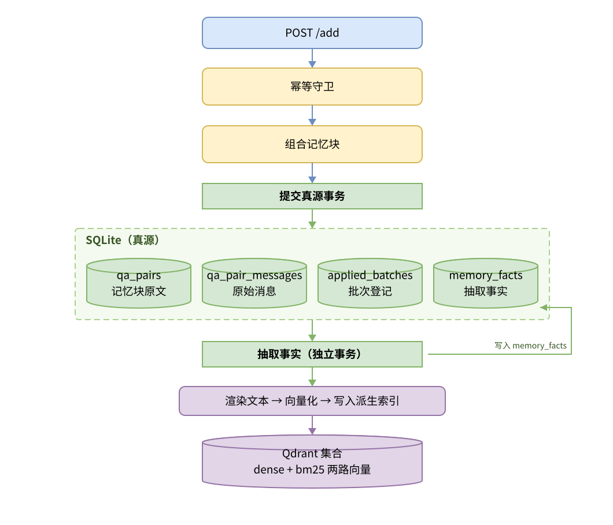
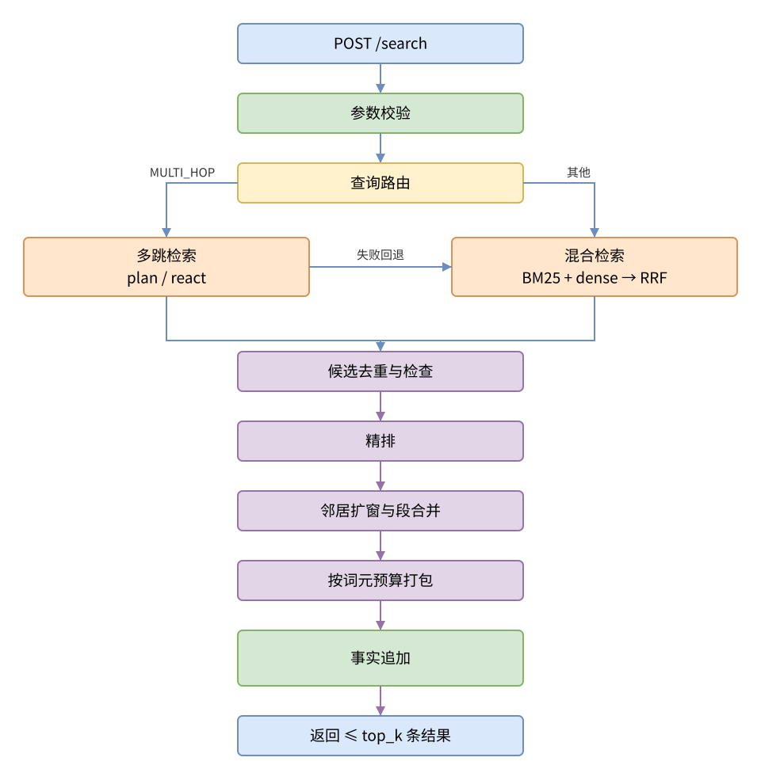

# TianXiMem

TianXiMem 是一个 AML Agentic Memory 服务。它只实现 `Add` 与 `Search` 两个业务端点，
另有一个无副作用的 `GET /health` 存活探针；答案生成、判分与汇总仍由 AML 负责。

## 运行时

### Add 写入链路



### Search 检索链路



SQLite 是真源。Qdrant 与向量缓存都是可重建的派生状态。服务以单进程运行，不可横向
扩容。

## 优化设计

### 优化一：多跳记忆

**难点**：单条原始问题的语义信息不足，一次检索往往只覆盖第一跳，或者中间跳数，后续跳数因缺少中间实体信息而无法展开。

**设计**：将检索改为循环执行，每轮基于已有证据决定下一步查询问题。设计系统保留两套实现。

React 模式：每轮检索后由模型判断证据是否充分、选取证据并给出下一轮查询，循环至满足停止条件。不预设跳数，但是设置最大跳数限制防止死循环。

Plan 模式：开始前由模型将问题拆解为 1 至 4 步的有序计划，每步用占位符引用前一步的答案，按计划顺序执行。计划确定后不再变更。若计划拆解失败，程序侧改用原始问题补充一次检索。

两种模式均不生成最终答案，只产出记忆信息。

### 优化二：记忆治理

**难点**：同一属性会被多次陈述，属性值会发生变更。全部保留则无法确定当前有效值，只保留最新值则丢失历史状态。

**设计**：针对记忆治理的常见场景，进行事实取证，全量保留，读取时统一判断。

每条陈述独立入库并携带时间戳。抽取时由模型判定该句是否显式声明了取代关系，是则在事实行上标记为更新句，取代对象仍留在同一条来源引句中，不做删改。

读取时按主体与关系分组，取组内时间最新的更新批次作为当前时点，只返回三部分：该批更新句本身、该时点之后与该批次取值一致的普通陈述，以及时间缺失无法定位的陈述。该时点之前的普通陈述与其它中间取值留在库中但不返回。

| 关系 | 主体 | 客体 | 时间 | 读出 |
| --- | --- | --- | --- | --- |
| performer | zhoujielun | xusong | 03-01 | 旧，不返回 |
| performer | zhoujielun | linjunjie | 03-10 | 更新，返回 |
| performer | zhoujielun | linjunjie | 04-02 | 与当前一致，返回 |

旧态与新态并存，中间出现的其他取值同样保留，但只有当前批次是读取时的有效值。


### 优化三：时序推理

**难点**：相对时间表达脱离其被表述的时间点后没有确定指称，模型能力无法据此推算具体日期。

**设计**：在相对表达之后追加按锚点计算的绝对日期，原文保持不变。

```text
I went yesterday        ->  I went yesterday (March 14, 2024)
```

三项约束：

1. 只追加，不替换。相对形式与绝对形式并存。
2. 锚点取该条记忆自身的日期，不取查询时的当前日期。跨时段对话中每条陈述按各自的表述日期计算。
3. 无法推算具体日期时不做处理，不生成推测值。


### 优化四：临窗扩展

**难点**：检索命中的是单个记忆块，而答案所需信息常分布在其前后相邻块中。仅返回命中块会缺失上下文。

**设计**：命中后沿存储中的相邻指针补充上下文。

记忆写入时记录前后相邻指针。检索命中后从种子块出发，沿指针双向各扩展两跳，将相邻块纳入结果集。
扩展范围限定在同一会话、同一批次内，不做跨批次拼接。

## 环境要求

- Python 3.11 至 3.12（容器镜像使用 3.12）
- `uv`
- 带 Compose 的 Docker
- 一个 OpenAI 兼容的向量化端点
- 一个 OpenAI 兼容的对话端点（`v1.0` 兼容档位除外，它关掉了路由与多跳）
- 一个 OpenAI 兼容的精排端点（缺失时检索退回 RRF 顺序，不影响启动）

## 模型

| 组件 | 模型 |
| --- | --- |
| 向量模型 | `text-embedding-v4` |
| 对话模型 | `gpt-4o-mini` |
| 精排模型 | `qwen3.7-text-rerank` |

`configs/local.yaml` 的开发档位把向量模型换成自建的 `Qwen/Qwen3-Embedding-4B`，
其余档位一律使用上表。对话模型由 `AML_MODEL` 指定，精排模型由
`TIANXIMEM_RERANKER_MODEL` 指定。

## 启动服务

两种方式，区别仅在于应用跑在宿主机还是容器里；配置与接口完全相同。

两种方式在启动前都需要准备好端点配置：

1. **向量化端点（必需）**：`AML_EMB_BASE_URL`、`AML_EMB_API_KEY`。
2. **对话端点（必需）**：`AML_BASE_URL`、`AML_API_KEY`、`AML_MODEL`。`default`、`local`、
   `submit` 等档位都启用了路由器与多跳执行器，缺它会启动失败；只有 `v1.0` 兼容档位
   （路由与多跳均关闭）不需要。
3. **精排端点（可选）**：`TIANXIMEM_RERANKER_BASE_URL`、`TIANXIMEM_RERANKER_API_KEY`。
   它不参与启动校验：`rerank.enabled = true` 但端点为空的，服务照常启动，只在日志里记
   一条 warning，检索退回 RRF 顺序。评测档位应把这两个值填上。

上述必需项没有可用的默认值，服务在启动时校验，值为空即拒绝运行。若容器反复重启，
几乎总是这条校验导致的：

```bash
docker compose -f deploy/compose.yaml logs --tail=30 app
```

### 方式一：本地 Python

Qdrant 跑在容器里，应用跑在宿主机上。

```bash
# 1. 配置。编辑 .env，填入向量化与对话端点。
cp .env.example .env

# 2. 安装依赖。
uv sync

# 3. 启动 Qdrant（若已可通过 TIANXIMEM_QDRANT_URL 访问，可跳过）。
uv run python -m tianximem.dev qdrant-up

# 4. 校验配置。
uv run python -m tianximem.dev config-check

# 5. 运行 API。
uv run python -m tianximem.dev serve
```

默认使用 `configs/default.yaml`。在 `.env` 中设置 `TIANXIMEM_PROFILE=local` 可切换到
开发档位：独立集合 `memories_dev`，向量模型换成自建的 `Qwen/Qwen3-Embedding-4B`。

### 方式二：Docker Compose

在本地构建镜像，并把应用与 Qdrant 一并启动。

```bash
# Compose 读取 deploy/.env 既用于插值，也作为容器环境，须写入真实端点。
cp deploy/.env.example deploy/.env

docker compose -f deploy/compose.yaml up -d --build
docker compose -f deploy/compose.yaml ps
```

启动后可做一次验证：

```bash
docker compose -f deploy/compose.yaml exec app python -m tianximem.dev config-check
curl -s http://127.0.0.1:8000/health
```

停止服务栈：

```bash
docker compose -f deploy/compose.yaml down
```

除非确实要连同已存储的记忆一起删除，否则不要加 `-v`。

## 接口

健康检查：

```bash
curl -s http://127.0.0.1:8000/health
```

写入：

```bash
curl -s -X POST http://127.0.0.1:8000/add \
  -H 'Content-Type: application/json' \
  -d '{
    "request_id": "example-1",
    "user_id": "user-1",
    "session_id": "session-1",
    "messages": [
      {"role": "user", "content": "I moved to Hangzhou.", "timestamp": 1697900000000},
      {"role": "assistant", "content": "Noted."}
    ]
  }'
```

检索：

```bash
curl -s -X POST http://127.0.0.1:8000/search \
  -H 'Content-Type: application/json' \
  -d '{"user_id": "user-1", "query": "Where did the user move?", "top_k": 10}'
```

合法的写入请求至少包含一条 `content` 非空的消息。检索结果最多包含 `top_k` 条证据，
永不包含生成的答案。

## 容器部署

镜像只包含应用本身，没有发布到镜像仓库，需从代码检出构建：

```bash
docker compose -f deploy/compose.yaml up -d --build

# 或只构建镜像
docker build -f deploy/Dockerfile -t tianximem:local .
```

容器把状态保存在 `/data` 下，Compose 将其挂载为命名卷；该卷需要备份，也是重启后仍然
保留的部分。

构建过程的所有对外下载都可覆盖，受限网络无需修改 Dockerfile：

```bash
docker build -f deploy/Dockerfile \
  --build-arg PYTHON_IMAGE=docker.m.daocloud.io/library/python:3.12-slim-bookworm \
  --build-arg PYPI_INDEX=https://pypi.tuna.tsinghua.edu.cn/simple \
  -t tianximem:local .
```

`uv.lock` 锁定的是 `https://pypi.org/simple`，因此 `PYPI_INDEX` 必须是逐字一致的
镜像源。

## 配置

需要配置两个文件：

- `.env`（容器部署时为 `deploy/.env`）：凭据与端点，包括 `AML_EMB_BASE_URL`、
  `AML_EMB_API_KEY`、`AML_BASE_URL`、`AML_API_KEY`、`AML_MODEL` 与精排端点。
- `configs/default.yaml`：阈值、权重、向量模型标识、集合名与功能开关。

通过 `TIANXIMEM_PROFILE` 选择档位，默认使用 `default`，即评测应使用的档位。`configs/`
下的其余档位只用于开发调试。未知的 YAML 键会导致启动校验失败。

## 文档

- 架构图：[`docs/diagrams/`](docs/diagrams/)
- HTTP 契约：见上文「接口」一节
